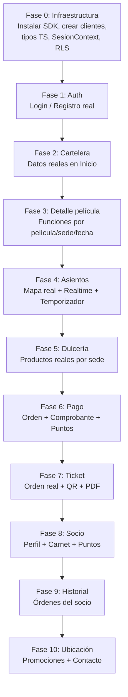

# Plan de Desarrollo — CineNáutica MVP (Fase Cliente)
> ANTES DE LEER EL PLAN HABER LEIDO "AGENTS.md" y "MEMORY.md" en docs/ para mejor contexto y estado actual. 
> Verdad, cualquier patron de diseño que vayas a implementar me vas diciendo y anotando en "MEMORY.md", obvio los que sean necesarios claro.

## Objetivo
Reemplazar toda la lógica demo/stub de las vistas del **cliente** por lógica real conectada a Supabase (Auth + PostgreSQL). Esto incluye: autenticación, cartelera, detalle de película, flujo de compra completo (asientos → dulcería → pago → ticket), perfil socio e historial.

> [!IMPORTANT]
> Este plan cubre **solo las vistas de Cliente**. Al terminar, seguiremos con: Acceso → Counter → Admin_Sede → Admin_General, en ese orden.

---

## Estado Actual del Proyecto

| Área | Estado |
|---|---|
| Frontend / UI | ✅ Completamente diseñado (demo) |
| `src/lib/ui/*.ts` | ⚠️ Solo manipulación de DOM con datos hardcodeados |
| `src/daos/` | ❌ Vacío |
| `src/services/` | ❌ Vacío |
| `src/dtos/` | ❌ Vacío |
| `src/lib/supabase/auth.ts` | ❌ Vacío |
| Supabase instalado en proyecto | ❌ Falta instalar `@supabase/supabase-js` |
| RLS activado | ❌ **Ninguna tabla tiene RLS** (crítico) |

### Base de datos Supabase (45 tablas existentes)
Tablas clave para la fase Cliente:
- `region`, `ciudad`, `sede`, `sala`, `sala_formato`
- `pelicula`, `genero`, `genero_pelicula`, `pelicula_formato`, `pelicula_sede`
- `funcion`, `asiento`, `asiento_funcion`, `bloqueo_temporal`
- `tarifa`, `tarifa_sede`, `tipo_entrada`, `tipo_entrada_sede`, `feriado`
- `categoria_producto`, `producto`, `producto_sede`
- `cupon`, `cupon_sede`
- `orden`, `detalle_entrada`, `detalle_producto`, `pago`, `comprobante`
- `usuario`, `socio`, `nivel_socio`, `historial_puntos_socio`
- `parametro_sistema`

---

## User Review Required

> [!WARNING]
> **RLS desactivado en todas las tablas.** El proyecto actualmente expone todos los datos con el `anon_key`. Antes de arrancar con la lógica de negocio real, debemos definir e implementar las políticas RLS. Propongo hacerlo como **Paso 0** del plan. 
> RESPUESTA: Lo iremos poniendo mientras desarrollamos mejor, al terminar algun flujo implementamos las politicas RLS correspondiente a la tabla que influya poco a poco.


> [!IMPORTANT]
> **Pago con Culqi.** El `.env.example` tiene claves de Culqi, pero el flujo de pago real (cargo a tarjeta / Yape) requiere integración con su API. Para este MVP, ¿lo implementamos como pago simulado (guardando la orden en BD pero sin cargo real) o necesitas la integración real con Culqi?
> RESPUESTA: Demomento lo dejamos como un pago simulado que se guarde enla BD, nos falta registrarnos en Culqi para implementarlo.
---

## Open Questions

> [!IMPORTANT]
> **¿Cómo manejar el contexto de sesión entre rutas?** Actualmente se usa `S` y `SEL` como objetos en memoria en `nav.ts`. Con Supabase Auth, la sesión se mantendrá via cookies/localStorage. ¿Aprobás que reemplacemos `S.sesion` con la sesión real de Supabase y `SEL` con un store React (Context o Zustand)?
> RESPUESTA: Siii, reemplazalo noma con la sesion real de supabase.


> [!IMPORTANT]
> **¿Hay datos de prueba en la BD?** Hay `pelicula` (3 filas), `funcion` (9 filas), `asiento` (442 filas), `tarifa` (8 filas), `producto` (5 filas). ¿Son datos reales listos para mostrar, o necesitan ajuste/completarse antes de empezar?
> RESPUESTA: Son datos de prueba, pero si faltan agregar lo podremos hacer sin problema cuando lo necesitemos ahi me avisas y registramos todo cambio en "supabase/migrations".

> [!NOTE]
> **Política de bloqueo temporal de asientos.** La tabla `bloqueo_temporal` existe. ¿El temporizador de 5 min que limpia los bloqueos lo manejamos desde el frontend (cancelando en `onUnmount`) o necesitás un job en Supabase que limpie bloqueos expirados automáticamente?
> RESPUESTA: Implementa el job en supabase, el frontend solo mostrara el temporizador con el tiempo, cuando lo implementes lo registras en "supabase/migrations"

---

## Proposed Changes

Las fases se ejecutan **en orden estricto**, módulo por módulo, con revisión tuya al terminar cada una.

---

### FASE 0 — Infraestructura Base

#### [MODIFY] package.json
Instalar dependencias necesarias:
```bash
npm install @supabase/supabase-js @supabase/ssr
```

#### [NEW] src/lib/supabase/cliente.ts
Cliente Supabase para componentes del lado del cliente (browser):
```typescript
import { createBrowserClient } from '@supabase/ssr';
import type { Database } from './types';

export const supabase = createBrowserClient<Database>(
  process.env.NEXT_PUBLIC_SUPABASE_URL!,
  process.env.NEXT_PUBLIC_SUPABASE_ANON_KEY!
);
```

#### [NEW] src/lib/supabase/servidor.ts
Cliente para Server Components / Route Handlers (cookies):
```typescript
import { createServerClient } from '@supabase/ssr';
import { cookies } from 'next/headers';
```

#### [MODIFY] src/lib/supabase/auth.ts *(actualmente vacío)*
Funciones de autenticación reales:
- `iniciarSesion(email, password)` → `supabase.auth.signInWithPassword`
- `registrarse(datos)` → `supabase.auth.signUp` + INSERT en `usuario` y `socio`
- `cerrarSesion()` → `supabase.auth.signOut`
- `obtenerSesionActual()` → `supabase.auth.getUser`

#### [NEW] src/lib/supabase/types.ts
Tipos TypeScript generados desde el esquema de Supabase:
```bash
npx supabase gen types typescript --project-id cnzkhskrhgarmexqbyzh > src/lib/supabase/types.ts
```

#### [NEW] src/context/SesionContext.tsx
Context de React que envuelve la app con la sesión activa de Supabase:
- Estado: `{ usuario, socio, cargando }`
- Se suscribe a `supabase.auth.onAuthStateChange`
- Expone: `{ usuario, socio, iniciarSesion, registrarse, cerrarSesion }`

#### [MODIFY] src/app/layout.tsx
Envolver con `<SesionProvider>`.

#### Políticas RLS (requiere aprobación tuya para ejecutar)
SQL propuesto por tabla — **a revisar contigo antes de aplicar**.

---

### FASE 1 — Autenticación (Modal Login / Registro)
> NOTA: Ojo, el registro sera opcional puesto que el cliente podra comprar sin tener cuenta, eso seria como una sesion de Invitado donde podra realizar el flujo de compra sin problemas, ya si se registra seria Socio, dandole acceso a los beneficios de socio. Sino no.

**Archivos a tocar:**
- `src/lib/supabase/auth.ts`
- `src/components/cliente/ModalesGlobales.tsx`
- `src/lib/ui/cliente.ts` — reemplazar `manejarLogin` / `manejarRegistro`
- `src/components/cliente/Navbar.tsx` — mostrar nombre/avatar real del socio

**Lógica a implementar:**
- Login: `supabase.auth.signInWithPassword` → al éxito, actualizar `SesionContext`, cerrar modal, mostrar nombre real en navbar.
- Registro: validar campos (regex del AGENTS.md), `supabase.auth.signUp` → INSERT en `usuario` (nombre, apellido, dni, celular, fecha_nac) → INSERT en `socio` (código CIN-XXXXXX autogenerado, nivel Bronce).
- Cierre de sesión: `supabase.auth.signOut` → limpiar contexto.
- **Protección de rutas:** `/socio`, `/historial` requieren sesión activa de cliente.

---

### FASE 2 — Cartelera e Inicio (Vista Principal) ✅ COMPLETADA (2026-10-13)

**Archivos a tocar:**
- `src/components/cliente/vistas/Inicio.tsx`
- `src/lib/ui/cliente.ts` — `aplicarFiltroInicio`, `alCambiarCiudadInicio`
- `src/daos/PeliculaDao.ts` *(nuevo)*
- `src/daos/SedeDao.ts` *(nuevo)*
- `src/services/carteleraService.ts` *(nuevo)*

**DAOs nuevos:**

```typescript
// src/daos/PeliculaDao.ts
export async function obtenerCartelera(sedeId?: string, fecha?: Date) {
  // JOIN pelicula → pelicula_sede → funcion (filtrado por sede/fecha)
  // Retorna: id, titulo, generos, poster_url, duracion, clasificacion, formatos disponibles
}

// src/daos/SedeDao.ts
export async function obtenerSedes() {
  // SELECT sede con ciudad y región
}
```

**Lógica a implementar:**
- Reemplazar objeto `SEDES` hardcodeado por datos reales de la BD.
- Reemplazar cartelera estática: cargar películas + funciones desde Supabase filtradas por sede/fecha.
- El selector de ciudades y sedes se populan dinámicamente desde BD.
- Fechas reales (7 días desde hoy) en lugar de `d0-d6`.
- Carrusel con las películas en categoría `Estrenos` o `Pre-Estreno`.
- Filtros de cartelera: película, ciudad, sede, fecha → query a Supabase.

---

### FASE 3 — Detalle de Película y Selección de Función ✅ COMPLETADA (2026-10-14)

**Archivos a tocar:**
- `src/app/(cliente)/pelicula/[id]/page.tsx` *(nueva ruta dinámica real)*
- `src/components/cliente/detalle/` — reemplazar archivos hardcodeados por un componente dinámico
- `src/daos/FuncionDao.ts` *(nuevo)*
- `src/services/funcionService.ts` *(nuevo)*

**Estrategia — eliminar los Detalle_*.tsx hardcodeados:**
Los 10 archivos en `src/components/cliente/detalle/` son datos de demo. Se reemplazarán por UN solo componente dinámico `DetallePelicula.tsx` que recibe el `id` de la URL y hace fetch a Supabase.

```typescript
// src/daos/FuncionDao.ts
export async function obtenerFuncionesPorPelicula(peliculaId: string) {
  // JOIN funcion → sala → sede → ciudad
  // Retorna: { sede, ciudad, fecha, hora, formato, sala, asientosDisponibles }
  // Agrupa por sede para el acordeón
}
```

**Lógica a implementar:**
- Filtros Ciudad → Sede → Fecha → Hora reales desde BD.
- Al seleccionar función: guardar en `SEL` (o Context) la función real (id, sede, fecha, formato, sala, hora).
- Barra de confirmación de horario → navega a `/asientos`.

---

### FASE 4 — Mapa de Asientos

**Archivos a tocar:**
- `src/components/cliente/vistas/Asientos.tsx`
- `src/daos/AsientoDao.ts` *(nuevo)*
- `src/services/asientoService.ts` *(nuevo)*
- `src/lib/ui/cliente.ts` — reemplazar `clickAsiento`

**DAOs nuevos:**

```typescript
// src/daos/AsientoDao.ts
export async function obtenerAsientosFuncion(funcionId: string) {
  // SELECT asiento JOIN asiento_funcion (estado), bloqueo_temporal
  // Retorna: { id, fila, columna, tipo, estado_funcion, bloqueado_por_sesion }
}

export async function bloquearAsiento(asientoFuncionId: string, sessionToken: string) {
  // INSERT INTO bloqueo_temporal con timestamp de expiración (+5 min)
  // Usa Supabase Realtime para notificar a otros clientes
}

export async function liberarAsientos(sessionToken: string) {
  // DELETE FROM bloqueo_temporal WHERE id_sesion = sessionToken
}
```

**Lógica a implementar:**
- Cargar mapa real desde BD (filas, columnas, tipo de asiento, estado).
- Estados visuales: `Disponible`, `Reservado/Ocupado`, `Mantenimiento`, `Pasadizo`, `Accesible`.
- **Supabase Realtime:** suscripción a cambios en `bloqueo_temporal` de la función actual → actualizar mapa en tiempo real.
- Al hacer clic en asiento disponible → INSERT en `bloqueo_temporal`.
- **Temporizador de 5 min:** al entrar, iniciar cuenta regresiva. En `onUnmount` o al llegar a 0, borrar bloqueos del token.
- **Gracia de 30 segundos:** modal de advertencia antes de liberar.
- **Límite 8 asientos:** validación en UI + en service.
- Asiento `Accesible` → modal de confirmación.
- Calcular precio por asiento: tarifa_base (día de semana / feriado) + recargo formato.

**Motor de Precios (en `asientoService.ts`):**
```typescript
export function calcularPrecioAsiento(
  diaFuncion: Date,
  formatoSala: string,
  tipoEntrada: string,
  tarifas: Tarifa[],
  esFeriado: boolean
): number {
  // 1. Tarifa base por día (Lun-Mié = Media, Mar = Económica, Jue-Dom = Alta)
  // 2. + Recargo por formato (3D=+5, XD=+8, 4DX=+15, D-BOX=+15, VIP=+20)
  // 3. × (1 - descuento por tipo de entrada)
}
```

---

### FASE 5 — Dulcería

**Archivos a tocar:**
- `src/components/cliente/vistas/Dulceria.tsx`
- `src/daos/ProductoDao.ts` *(nuevo)*
- `src/services/dulceriaService.ts` *(nuevo)*

**Lógica a implementar:**
- Cargar productos reales desde `producto JOIN producto_sede` filtrados por sede activa.
- Categorías dinámicas desde `categoria_producto`.
- Precios reales (con precio_sede si aplica).
- Dulcería directa: flujo sin película (modal de selección de sede → `/dulceria`).
- Resumen en tiempo real del pedido (cantidad × precio).

---

### FASE 6 — Pago y Comprobante

**Archivos a tocar:**
- `src/components/cliente/vistas/Pago.tsx`
- `src/daos/OrdenDao.ts` *(nuevo)*
- `src/daos/CuponDao.ts` *(nuevo)*
- `src/services/pagoService.ts` *(nuevo)*
- `src/app/api/checkout/route.ts` *(nuevo — Route Handler)*

**Lógica a implementar:**

**Cupones:** validar código vs `cupon JOIN cupon_sede`, verificar vigencia y límite de usos.

**Puntos Socio:**
- Mostrar saldo de puntos si hay sesión activa de cliente.
- Canje: mínimo 50 pts, 1 punto = S/ 0.10, máximo 50% del subtotal.
- Beneficio cumpleaños: verificar mes de nacimiento vs `fecha_nac` del socio.

**Tipos de comprobante:** Boleta (DNI) / Factura (RUC) con validaciones regex.

**Checkout (Route Handler protegido con service_role):**
```
POST /api/checkout
Body: { funcionId, asientosSeleccionados, productosSel, cupon?, usarPuntos?, comprobante }
→ Validar bloqueos temporales aún vigentes
→ INSERT orden + detalle_entrada + detalle_producto
→ INSERT pago (método, monto)
→ INSERT comprobante (tipo, correlativo)
→ UPDATE asiento_funcion.estado = 'Ocupado'
→ UPDATE socio.puntos_acumulados (si socio)
→ DELETE bloqueo_temporal (liberar bloqueo)
→ Return: { ordenId, codigo_qr }
```

> [!CAUTION]
> El checkout debe ejecutarse en una **transacción atómica**. Usaremos una Supabase RPC (función PostgreSQL) para garantizar atomicidad. Necesita tu aprobación para crear la función en BD.
> RESPUESTA: Aprobado, puedes crearlo pero recuerda escribir los cambios en "supabase/migrations"

---

### FASE 7 — Ticket / Boleta

**Archivos a tocar:**
- `src/components/cliente/vistas/Ticket.tsx`
- `src/daos/OrdenDao.ts` (ampliar)

**Lógica a implementar:**
- Cargar datos reales de la orden desde BD (asientos, película, sede, sala, fecha/hora, productos, total pagado, puntos ganados).
- Generar código QR del número de orden (con librería `qrcode.react`).
- Desglose IGV real (18%).
- Botón "Imprimir / PDF" funcional (95mm).
- Mostrar puntos ganados en esta compra.

---

### FASE 8 — Perfil Socio

**Archivos a tocar:**
- `src/components/cliente/vistas/Socio.tsx`
- `src/daos/SocioDao.ts` *(nuevo)*
- `src/services/socioService.ts` *(nuevo)*

**Lógica a implementar:**
- Cargar datos reales: nombre, código socio (CIN-XXXXXX), nivel, puntos, multiplicador.
- Carnet digital con nivel visual (Bronce/Plata/Oro) e indicador de progreso.
- Historial de movimientos de puntos desde `historial_puntos_socio`.
- Beneficio de cumpleaños: mostrar estado (disponible/reclamado/no aplica mes actual).

---

### FASE 9 — Historial de Compras ✅ COMPLETADA (2026-10-14)

**Archivos implementados:**
- `src/components/cliente/vistas/Historial.tsx` — Vista dinámica con estados de carga, búsqueda de invitados por correo, listado de órdenes reales de Supabase, badges de estado (`Pagada`, `Cancelada`, `Pendiente`), posters, detalles expandibles y redirección directa al ticket.
- `src/daos/OrdenDao.ts` — Ampliado con `obtenerOrdenesPorUsuario(idUsuario, correo)` que consulta órdenes, sedes, comprobantes, tickets y posters.
- `src/services/historialService.ts` — Lógica de negocio, formateador de fechas peruanas, cálculo de badges visuales y resúmenes de entradas y dulcería.
- `src/services/__tests__/historialService.test.ts` — 4 tests unitarios pasando al 100%.

---

### FASE 10 — Vistas Estáticas con Datos Reales ✅ COMPLETADA (2026-10-14)

**Archivos implementados:**
- `src/components/cliente/vistas/Ubicacion.tsx` — Sedes reales cargadas desde `SedeDao.obtenerSedes()`, mapa interactivo por coordenadas, horarios, teléfonos y redirección a cartelera por sede seleccionada.
- `src/components/cliente/vistas/Promociones.tsx` — Cupones activos cargados en tiempo real desde Supabase (`CuponDao.obtenerCuponesActivos()`), botón de copiado con feedback visual / toast y enlace a beneficios de Socio Náutica.
- `src/components/cliente/vistas/Contacto.tsx` — Formulario controlado con validación, feedback en tiempo real, guardado en tabla `mensaje_contacto` en Supabase y auto-completado para usuarios logueados.
- `src/daos/ContactoDao.ts` — DAO para persistencia de mensajes de atención al cliente.
- `supabase/migrations/20261014_006_contacto.sql` — Migración SQL para tabla `mensaje_contacto` con RLS.
- `src/daos/__tests__/contactoDao.test.ts` — Test de integración pasando.

---

## Arquitectura de Capas

```
Vista (React TSX)
    ↕
Service (lógica de negocio, validaciones, cálculos)
    ↕
DAO (queries a Supabase, tipado con Database types)
    ↕
Supabase Client (browser/server)
    ↕
PostgreSQL (Supabase)
```

Convención de nombres (per AGENTS.md):
- Variables de negocio y funciones → **español**
- Patterns, DAOs, tipos técnicos → **inglés**

---

## Secuencia de Ejecución Propuesta



---

## Verification Plan

### Por fase
Cada fase termina con:
1. ✅ `npm run build` sin errores TypeScript.
2. ✅ Verificación manual en el navegador con DevTools MCP (consola limpia, sin errores 4xx/5xx).
3. ✅ Prueba del flujo específico de la fase.
4. ✅ Actualización de `MEMORY.md`.

### Automatizados
No hay tests aún. Si querés, puedo proponer agregar Vitest para los services de negocio (precios, validaciones).
> RESPUESTA: Claro que si aprobado.
### Manual — Flujo de Compra Completo (Fases 2–7)
1. Entrar a cartelera → seleccionar película → ver funciones reales.
2. Seleccionar función → ir a asientos → verificar mapa real.
3. Seleccionar 2 asientos → verificar bloqueo en tiempo real desde otra pestaña.
4. Continuar → dulcería → agregar productos.
5. Ir a pago → aplicar cupón → completar comprobante → confirmar.
6. Verificar ticket con datos reales → descargar PDF.
7. Verificar puntos acumulados en perfil socio.
